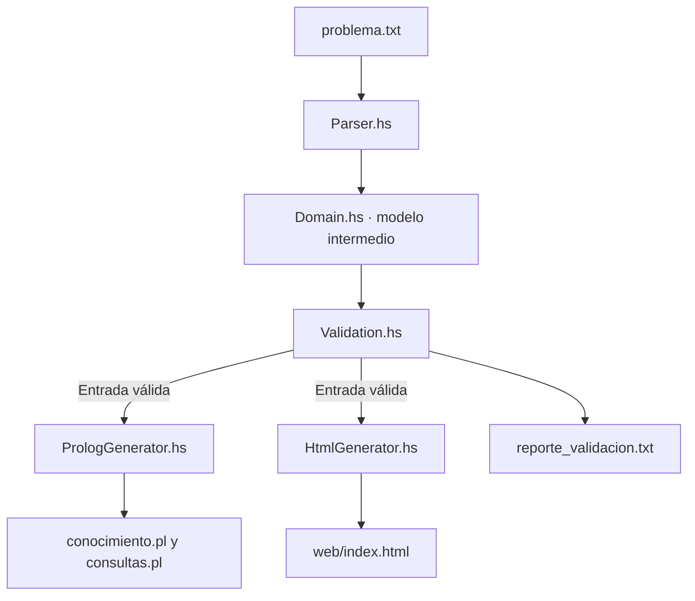

<div align="center">

# 🎓 Academic Logic

### Proyecto III · Paradigmas de Programación

**Pipeline funcional-lógico: Haskell → SWI-Prolog → Interfaz web**


*Del texto estructurado a hechos, inferencias y una visualización académica generada automáticamente.*

**Integrantes:** Justin Samuel Rojas Jarquin · Cristopher Eduardo Ureña Valverde · Anthony Villalobos Nuñez

</div>

---

## 📑 Contenido

1. [Integrantes](#-integrantes)
2. [Descripción](#-descripción)
3. [Características](#-características)
4. [Tecnologías y requisitos](#-tecnologías-y-requisitos)
5. [Estructura del proyecto](#-estructura-del-proyecto)
6. [Instalación y ejecución](#-instalación-y-ejecución)
7. [Formato de entrada](#-formato-de-entrada)
8. [Archivos generados](#-archivos-generados)
9. [Consultas en Prolog](#-consultas-en-prolog)
10. [Validaciones](#-validaciones)
11. [Pruebas](#-pruebas)
12. [Documentación con Doxygen](#-documentación-con-doxygen)
13. [Defensa y solución de problemas](#-defensa-y-solución-de-problemas)

## 👥 Integrantes

| Nombre completo | Participación |
|---|---|
| **Justin Samuel Rojas Jarquin** | Integrante del equipo |
| **Cristopher Eduardo Ureña Valverde** | Integrante del equipo |
| **Anthony Villalobos Nuñez** | Integrante del equipo |

## 🌟 Descripción

**Academic Logic** es un proyecto integrador del dominio académico. Lee un archivo `problema.txt` con estudiantes, cursos, docentes, relaciones y reglas solicitadas. Haskell interpreta y valida la entrada mediante un **modelo intermedio con tipos propios**. A continuación, genera hechos y reglas para SWI-Prolog, consultas sugeridas, un reporte de validación y un panel HTML.

La interfaz **no se escribe manualmente para cada problema**: se regenera a partir del mismo modelo intermedio que alimenta el generador Prolog.

### Flujo de procesamiento



`Main.hs` coordina la lectura y escritura; las transformaciones principales se realizan mediante funciones puras.

## ✨ Características

- Parsing de secciones `[ENTIDADES]`, `[RELACIONES]` y `[REGLAS_SOLICITADAS]`.
- Entidades tipadas: `Estudiante`, `Curso` y `Docente`.
- Validación de sintaxis, referencias, tipos y duplicados.
- Hechos Prolog con **trazabilidad por línea de origen**.
- Reglas académicas generadas solo si se solicitan.
- Serialización de nombres como átomos Prolog, incluidos espacios, tildes y apóstrofes.
- Interfaz oscura y adaptable con estadísticas, tablas, código Prolog, consultas y reporte.
- Regeneración al cambiar el archivo de entrada, sin modificar los generadores.
- Eliminación de salidas anteriores ante errores, para evitar resultados obsoletos.

## 🧰 Tecnologías y requisitos

| Herramienta | Uso | Versión utilizada en las pruebas |
|---|---|---|
| GHC / GHCi | Compilación e intérprete de Haskell | 9.10.3 |
| Cabal | Herramientas de desarrollo Haskell | 3.16.1.0 |
| SWI-Prolog | Ejecución de hechos y reglas | 10.1.17 |
| Doxygen | Documentación HTML | 1.18.0 |
| Navegador moderno | Visualización de `index.html` | — |
| Visual Studio Code | Editor recomendado | — |

Instaladores oficiales: [GHCup](https://www.haskell.org/ghcup/install/), [SWI-Prolog](https://www.swi-prolog.org/download/stable), [Doxygen](https://www.doxygen.nl/download.html) y [VS Code](https://code.visualstudio.com/).

> **Sistema de referencia:** Windows, terminal **CMD**. Los comandos siguientes se ejecutan desde la carpeta principal del proyecto.

Para comprobar que las herramientas son accesibles desde la terminal:

```cmd
ghc --version
cabal --version
swipl --version
doxygen --version
```

Si un comando no se reconoce, comprueba primero su instalación y la variable de entorno `PATH`.

## 🗂️ Estructura del proyecto

```text
Proyecto III Paradigmas/
├── haskell/
│   └── src/
│       ├── Domain.hs
│       ├── Parser.hs
│       ├── Validation.hs
│       ├── PrologGenerator.hs
│       ├── HtmlGenerator.hs
│       └── Main.hs
├── data/
│   ├── input/
│   │   └── problema.txt
│   └── output/
│       ├── conocimiento.pl           [generado]
│       ├── consultas.pl              [generado]
│       └── reporte_validacion.txt    [generado]
├── web/
│   └── index.html                    [generado]
├── tests/
│   └── test01_...txt hasta test13_...txt
├── docs/
│   ├── ARQUITECTURA.md
│   ├── FUNCIONES.md
│   ├── Doxyfile
│   └── html/                        [generado por Doxygen]
├── hie.yaml
├── .gitignore
└── README.md
```

| Módulo | Responsabilidad |
|---|---|
| `Domain.hs` | Tipos de datos del modelo intermedio |
| `Parser.hs` | Parsing funcional del texto y registro de errores de formato |
| `Validation.hs` | Validaciones semánticas y reporte |
| `PrologGenerator.hs` | Hechos, reglas y consultas Prolog |
| `HtmlGenerator.hs` | Construcción automática de la interfaz |
| `Main.hs` | Orquestación del pipeline y manejo de archivos |

## 🚀 Instalación y ejecución

### 1. Abrir el proyecto

En Visual Studio Code, selecciona **Archivo → Abrir carpeta** y elige `Proyecto III Paradigmas`. Abre la terminal integrada en la raíz del proyecto.

### 2. Comprobar compilación

```cmd
ghc -fno-code -ihaskell\src haskell\src\Main.hs
```

`-fno-code` comprueba los seis módulos sin generar un ejecutable; `-i` indica dónde buscar los módulos locales.

### 3. Ejecutar el pipeline

```cmd
runghc -ihaskell\src haskell\src\Main.hs
```

El comando lee `data/input/problema.txt` y genera los cuatro productos. Una ejecución válida muestra mensajes `[OK]` y concluye con `Pipeline completado correctamente.`

### 4. Abrir la interfaz

```cmd
start web\index.html
```

La interfaz **Academic Logic** incluye un panel universitario profesional, tarjetas de
estadisticas, navegacion lateral con indicador de seccion, tablas de entidades
y relaciones, codigo Prolog y reporte de validacion. Es adaptable a pantallas
pequenas, respeta la preferencia de movimiento reducido y funciona sin conexion
a Internet ni dependencias JavaScript externas. Los datos no estan escritos
directamente en HTML: `HtmlGenerator.hs` regenera la pagina con cada entrada.
Los archivos de salida se escriben explicitamente con codificacion UTF-8 para
conservar tildes, nombres internacionales y caracteres especiales en Windows.

La version UNA utiliza un estilo propio de software academico (rojo, blanco y
azul carbon, sin escudos ni logos oficiales). Los iconos originales estan en
`web/assets/iconos-academicos.png` y los estilos en `web/assets/una-ui.css`.
Ambos son necesarios al abrir `web/index.html`, asi que no deben separarse.
La documentacion comparte esta identidad visual mediante
`docs/una-doxygen.css` y `HTML_EXTRA_STYLESHEET` en `docs/Doxyfile`.

### 5. Ejecutar otro problema sin modificar código

```cmd
runghc -ihaskell\src haskell\src\Main.hs tests\test07_segundo_problema.txt
```

La ruta opcional sustituye únicamente el archivo de entrada de esa ejecución. Los archivos generados se escriben en las mismas rutas de salida.

## 📝 Formato de entrada

Ejemplo de `data/input/problema.txt`:

```text
[ENTIDADES]
estudiante: Ana
estudiante: Luis
curso: Paradigmas
docente: Maria

[RELACIONES]
lleva: Ana, Paradigmas
lleva: Luis, Paradigmas
imparte: Maria, Paradigmas

[REGLAS_SOLICITADAS]
companeros
curso_con_docente
comparte_docente
```

### Contrato del dominio

| Elemento | Formato / significado |
|---|---|
| `estudiante: Nombre` | Declara estudiante |
| `curso: Nombre` | Declara curso |
| `docente: Nombre` | Declara docente |
| `lleva: Estudiante, Curso` | Matrícula de un estudiante |
| `imparte: Docente, Curso` | Curso impartido por un docente |
| `companeros` | Estudiantes distintos en un mismo curso |
| `curso_con_docente` | Curso asociado con su docente |
| `comparte_docente` | Estudiantes con al menos un docente en común |

Las tres secciones son obligatorias. Los nombres utilizados por las relaciones deben estar declarados con el tipo adecuado. Se admiten líneas vacías y comentarios que comienzan por `#`.

## 📤 Archivos generados

| Salida | Contenido |
|---|---|
| `data/output/conocimiento.pl` | Hechos, relaciones, reglas y comentarios de trazabilidad |
| `data/output/consultas.pl` | Carga de la base y ejemplos de consultas comentadas |
| `data/output/reporte_validacion.txt` | Errores y advertencias |
| `web/index.html` | Panel de conocimiento generado desde el modelo |

Ejemplo de hechos:

```prolog
% linea 2: entidad estudiante
estudiante('Ana').

% linea 7: relacion lleva
lleva('Ana', 'Paradigmas').
```

Los números de línea anteriores son ilustrativos; el generador escribe los de cada archivo real.

### Política de errores

- **Error:** el pipeline se detiene, guarda el reporte y retira `conocimiento.pl`, `consultas.pl` e `index.html` anteriores.
- **Advertencia:** informa duplicados y permite generar resultados; los hechos y reglas repetidos se emiten una sola vez.

## 🧠 Consultas en Prolog

Inicia SWI-Prolog con la base generada:

```cmd
swipl -s data\output\consultas.pl
```

En el indicador `?-`, escribe las consultas:

```prolog
estudiante('Ana').
lleva('Ana', Curso).
companero('Ana', X).
curso_con_docente('Paradigmas', Docente).
comparte_docente('Ana', 'Luis').
```

`companero/2` exige que los estudiantes sean distintos y lleven al menos un curso común. `comparte_docente/2` acepta cursos distintos si están impartidos por el mismo docente. Las reglas disponibles dependen de lo solicitado en el archivo de entrada.

Para pedir más soluciones, escribe `;`. Para terminar una consulta, presiona Enter. Para salir del intérprete:

```prolog
halt.
```

## 🛡️ Validaciones

| Validación | Dónde se realiza | Comportamiento |
|---|---|---|
| Sección ausente o repetida | Parser | Error |
| Encabezado desconocido | Parser | Error |
| Declaración con formato inválido | Parser | Error |
| Regla desconocida | Parser | Error |
| Entidad duplicada | Validation | Advertencia |
| Relación duplicada | Validation | Advertencia |
| Regla repetida | Validation | Advertencia |
| Entidad inexistente | Validation | Error |
| Tipo incompatible en relación | Validation | Error |

## 🧪 Pruebas

Los casos se encuentran en `tests/` y se ejecutan pasando la ruta correspondiente al programa:

```cmd
runghc -ihaskell\src haskell\src\Main.hs tests\test03_entidad_inexistente.txt
```

| N.º | Archivo | Objetivo |
|---:|---|---|
| 01 | `test01_valido.txt` | Entrada académica válida |
| 02 | `test02_duplicados.txt` | Duplicados y advertencias |
| 03 | `test03_entidad_inexistente.txt` | Referencia inexistente |
| 04 | `test04_formato_invalido.txt` | Errores de sintaxis |
| 05 | `test05_seccion_faltante.txt` | Sección obligatoria ausente |
| 06 | `test06_regla_invalida.txt` | Regla desconocida |
| 07 | `test07_segundo_problema.txt` | Regeneración con otros datos |
| 08 | `test08_tipos_incorrectos.txt` | Tipos de entidad incompatibles |
| 09 | `test09_secciones_repetidas.txt` | Encabezado repetido |
| 10 | `test10_nombres_especiales.txt` | Unicode y apóstrofes |
| 11 | `test11_duplicados_prolog.txt` | Hechos Prolog sin repeticiones |
| 12 | `test12_regeneracion.txt` | Recuperación tras una entrada inválida |
| 13 | `test13_consultas_prolog.txt` | Consultas positivas y negativas |

**Prueba adicional de robustez:** aunque no existan relaciones de un tipo, los
predicados Prolog correspondientes quedan declarados y las consultas devuelven
`false` en vez de producir un error de predicado desconocido.

**Nota:** Las pruebas 12 y 13 requieren también comprobar las salidas, la interfaz o realizar consultas en SWI-Prolog. La existencia de un archivo `.txt` por sí sola no constituye toda la prueba.

## 📚 Documentación con Doxygen

La documentación técnica parte de:

- `docs/ARQUITECTURA.md`: diseño, modelo y flujo general.
- `docs/FUNCIONES.md`: referencia de tipos, funciones y responsabilidades.
- `docs/Doxyfile`: configuración de Doxygen.

Desde la raíz del proyecto:

```cmd
doxygen docs\Doxyfile
start docs\html\index.html
```

La configuración incorpora archivos Markdown y muestra las fuentes Haskell/Prolog para consulta. **Doxygen no analiza Haskell con la misma profundidad que lenguajes soportados nativamente**; la referencia Markdown complementa esa limitación.

## 🎤 Defensa y solución de problemas

### Cómo demostrar el requisito principal

1. Mostrar `data/input/problema.txt`.
2. Ejecutar `runghc -ihaskell\src haskell\src\Main.hs`.
3. Abrir `web/index.html` y `conocimiento.pl`.
4. Cargar `consultas.pl` en SWI-Prolog y ejecutar una regla.
5. Procesar `tests\test07_segundo_problema.txt` y mostrar los cambios en los cuatro productos.
6. Ejecutar un caso inválido y enseñar `reporte_validacion.txt`.

### Preguntas frecuentes

**¿Por qué usamos un modelo intermedio?** Para separar el formato del TXT de las transformaciones y validar datos tipados antes de generar salidas.

**¿Qué parte es funcional?** El parser, las validaciones y los generadores utilizan funciones puras, tipos algebraicos, patrones y transformaciones de listas.

**¿Qué parte es lógica?** Los predicados Prolog representan hechos y deducen relaciones mediante reglas.

**¿Se edita el HTML a mano?** No. `HtmlGenerator.hs` lo construye desde el modelo intermedio.

**¿Qué pasa si hay un error?** Se registra en el reporte y no se conservan las salidas ejecutables antiguas.

### Problemas comunes

| Problema | Comprobación o solución |
|---|---|
| `ghc` no se reconoce | Revisar `PATH`, normalmente `C:\ghcup\bin` |
| `Could not find module Domain` en VS Code | Verificar `hie.yaml` y la opción `-ihaskell/src`; reiniciar HLS |
| `Variable not in scope` en GHCi | Cargar módulos con `:load`, después crear las variables interactivas |
| SWI-Prolog no encuentra consultas | Ejecutar el comando desde la raíz del proyecto |
| Doxygen muestra caracteres/tags desconocidos | Revisar que `Doxyfile` contenga solo configuración |
| No existe `web/index.html` | Comprobar el reporte; una ejecución fallida elimina salidas anteriores |

---

<div align="center">

**Proyecto III · Paradigmas de Programación**

*Un modelo tipado, una base lógica y una interfaz sincronizada.*

</div>
